  

  <a href="https://scholar.google.com/citations?user=3r5SETYAAAAJ&hl=en"><picture><source media="(prefers-color-scheme: dark)" srcset="assets/link-scholar-dark.svg"></picture></a>
  <a href="https://orcid.org/0000-0002-6299-9556"><picture><source media="(prefers-color-scheme: dark)" srcset="assets/link-orcid-dark.svg"></picture></a>
  <a href="https://www.researchgate.net/profile/Bushran-N-Iqbal"><picture><source media="(prefers-color-scheme: dark)" srcset="assets/link-researchgate-dark.svg"></picture></a>
  <a href="https://loop.frontiersin.org/people/2158213/overview"><picture><source media="(prefers-color-scheme: dark)" srcset="assets/link-loop-dark.svg"></picture></a>
  <a href="https://scholargps.com/scholars/86095595769584/bushran-n-iqbal"><picture><source media="(prefers-color-scheme: dark)" srcset="assets/link-scholargps-dark.svg"></picture></a>
  <a href="https://sciprofiles.com/profile/4598935"><picture><source media="(prefers-color-scheme: dark)" srcset="assets/link-sciprofiles-dark.svg"></picture></a>

## About

I work in medical virology and molecular biology, where laboratory diagnostics meet disease surveillance. I am at the Institute of Biotechnology, Life Sciences Center, Vilnius University. Most of my published work comes from the University of Peradeniya, Sri Lanka, with collaborators at The University of Hong Kong.

- **Genomic surveillance.** Tracked SARS-CoV-2 variants and their molecular epidemiology across the Kandy District of Sri Lanka, with The University of Hong Kong (*Viruses*, 2025).
- **One Health.** Coronavirus detection in bats, wildlife rodents and farm animals across several provinces of Sri Lanka.
- **Arboviruses.** Dengue virus serotypes and vertical transmission in *Aedes* larvae (*Parasites & Vectors*, 2021), the most cited of my papers.

## Research impact

<picture>
  <source media="(prefers-color-scheme: dark)" srcset="assets/metrics-dark.svg">
  
</picture>

## Featured research

<!--FEATURED:START-->

<a href="https://doi.org/10.1016/j.jcvp.2022.100081"><picture><source media="(prefers-color-scheme: dark)" srcset="assets/featured-1-dark.svg"></picture></a>
<a href="https://doi.org/10.3390/v17091189"><picture><source media="(prefers-color-scheme: dark)" srcset="assets/featured-2-dark.svg"></picture></a>
<a href="https://doi.org/10.1186/s13071-021-05114-5"><picture><source media="(prefers-color-scheme: dark)" srcset="assets/featured-3-dark.svg"></picture></a>
<a href="https://doi.org/10.1016/j.diagmicrobio.2023.116076"><picture><source media="(prefers-color-scheme: dark)" srcset="assets/featured-4-dark.svg"></picture></a>

<!--FEATURED:END-->

## Research landscape

  <picture><source media="(prefers-color-scheme: dark)" srcset="assets/themes-dark.svg"></picture>
  <picture><source media="(prefers-color-scheme: dark)" srcset="assets/output-dark.svg"></picture>

<picture>
  <source media="(prefers-color-scheme: dark)" srcset="assets/network-dark.svg">
  
</picture>

## Publications

<!--PUBLICATIONS:START-->
**2026**

- [Evaluation of a rapid antigen test using a point of care real-time RT-PCR as a comparator for the detection of SARS-CoV-2](https://doi.org/10.4038/cjs.v55i1.8664) JP Punchihewa, <b>BN Iqbal</b>, SRM Shihab, F Noordeen · <i>Ceylon Journal of Science</i> · open access

**2025**

- [Knowledge and attitude of allied health science students towards COVID-19 vaccination from a leading Sri Lankan university - A cross-sectional study](https://doi.org/10.4038/cjs.v54i1.8341) MIF Falilah, T Fernando, <b>BN Iqbal</b>, G Bowatte, F Noordeen · <i>Ceylon Journal of Science</i> · open access
- [Molecular Epidemiology of SARS-CoV-2 Detected from Different Areas of the Kandy District of Sri Lanka from November 2020–March 2022](https://doi.org/10.3390/v17091189) <b>BN Iqbal</b>, SRM Shihab, T Zhang, A Ahamed, S Arunasalam, SSSDS Jagoda, LLM Poon, MJS Peiris, F Noordeen · <i>Viruses</i> · open access

**2024**

- [Quality of the sample-based RNA determines the real-time RT-PCR results in the laboratory diagnosis of COVID-19](https://doi.org/10.1016/j.diagmicrobio.2023.116076) SRM Shihab, <b>BN Iqbal</b>, S Arunasalam, F Noordeen · <i>Diagnostic Microbiology and Infectious Disease</i> · 3 citations

**2023**

- Comparison of bat coronaviruses detected before and during the COVID-19 pandemic in a selected environment in the Central Province of Sri Lanka T Fernando, <b>BN Iqbal</b>, SMS Cheng, V Dhanasekaran, JSM Peiris, ... · <i>Sri Lankan Journal of Infectious Diseases</i> · 2 citations
- Surveillance of SARS-CoV-2 variants targeting SARS-CoV-2 spike protein mutations associated with variants of concern and variants of interest in the Central Province of Sri … <b>BN Iqbal</b>, SRM Shihab, S Arunasalam, SMS Cheng, JSM Peiris, ... · <i>Sri Lankan Journal of Infectious Diseases</i> · 1 citation
- [Assessing the effectiveness of sample and RNA extract pool testing for the detection of SARS-CoV-2 RNA by real time RT-PCR](https://doi.org/10.4038/sljid.v13i2.8574) MIH Sulthan, SRM Shihab, <b>BN Iqbal</b>, AP Pitawela, F Noordeen · <i>Sri Lankan Journal of Infectious Diseases</i> · open access
- Preliminary identification of coronaviruses in selected locations of Sri Lanka T Fernando, <b>BN Iqbal</b>, CG Wijesinghe, SMS Cheng, V Dhanasekaran, ... · <i>Sri Lankan Journal of Infectious Diseases</i>

**2022**

- [Diagnostic utility and validation of a newly developed real time loop mediated isothermal amplification method for the detection of SARS CoV-2 infection](https://doi.org/10.1016/j.jcvp.2022.100081) <b>BN Iqbal</b>, S Arunasalam, MVM Divarathna, AA Jabeer, PDNN Sirisena, T Senaratne, R Muthugala, F Noordeen · <i>Journal of Clinical Virology Plus</i> · 19 citations · open access
- [Relationship between clinical and laboratory features with infecting dengue virus serotypes in a sample of dengue suspected adult patients from 2015-2017 in Sri Lanka](https://doi.org/10.1016/j.jcvp.2022.100112) C Wijesinghe, AA Jabeer, <b>BN Iqbal</b>, F Noordeen · <i>Journal of Clinical Virology Plus</i> · 6 citations · open access
- [A pooled testing approach to COVID-19 screening by real time RT-PCR](https://doi.org/10.4038/sljid.v12i0.8560) HIM Sulthan, AP Pitawela, SRM Shihab, <b>BN Iqbal</b>, F Noordeen · <i>Sri Lankan Journal of Infectious Diseases</i> · open access
- [Comparison of a rapid antigen test with a point of care rtRT-PCR for the detection of SARS CoV-2](https://doi.org/10.4038/sljid.v12i0.8561) PHJP Punchihewa, <b>BN Iqbal</b>, SRM Shihab, F Noordeen · <i>Sri Lankan Journal of Infectious Diseases</i> · open access
- [Quality and quantity of RNA extracts and the correlation between gross RNA load and the Ct values in a real time RT-PCR used for the detection of SARS CoV-2](https://doi.org/10.4038/sljid.v12i0.8557) SRM Shihab, <b>BN Iqbal</b>, S Arunasalam, F Noordeen · <i>Sri Lankan Journal of Infectious Diseases</i> · open access

**2021**

- [Circulating dengue virus serotypes and vertical transmission in Aedes larvae during outbreak and inter-outbreak seasons in a high dengue risk area of Sri Lanka](https://doi.org/10.1186/s13071-021-05114-5) C Wijesinghe, J Gunatilake, PHD Kusumawathie, PDNN Sirisena, SWPL Daulagala, <b>BN Iqbal</b>, F Noordeen · <i>Parasites &amp; Vectors</i> · 28 citations · open access
- [Development and validation of a loop mediated isothermal amplification assay to detect severe acute respiratory syndrome corona virus-2](https://doi.org/10.4038/sljid.v11i0.8450) <b>BN Iqbal</b>, S Arunasalam, MVM Divarathna, AA Jabeer, T Senaratne, PDNN Sirisena, R Muthugala, F Noordeen · <i>Sri Lankan Journal of Infectious Diseases</i> · open access

<b>Conference presentations (13)</b>

- Detection of coronaviruses in both bats and humans in a common environment during the COVID-19 pandemic in the Central Province of Sri lanka FN T Fernando, AMSB Abeykoon, <b>BN Iqbal</b>, SMS Cheng, SMS Dhanasekaran, JSM Peiris · <i>46th Annual Academic Sessions of Kandy Society of Medicine (KSM 2024)</i> · 2024
- Detection of coronaviruses in wildlife rodents in the North Central Province, Sri Lanka FN Tharushi Fernando, <b>Bushran N Iqbal</b>, Samuel M.S Cheng, Vijakrishna ... · <i>University of Peradeniya International Research Symposium and Exposition …</i> · 2024
- Molecular epidemiology of SARS-CoV-2 infections in the central province of Sri Lanka: An Analysis from November 2020 to March 2022 <b>FN Bushran N Iqbal</b>, Sibra RM Shihab, Shiyamalee Arunasalam, Aadhil Ahamed ... · <i>46th Annual Academic Sessions of Kandy Society of Medicine (KSM 2024)</i> · 2024
- Temporal trends and demographic variations in Varicella Zoster Virus (VZV) seroprevalence across urban and rural communities in Kandy District, Sri Lanka TS Kariyawasam K, <b>Iqbal BN</b>, Tilakaratne N, Noordeen F · <i>Sri Lanka Medical Association,2024</i> · 2024
- Comparison of bat coronaviruses detected before and during the COVID-19 pandemic in a selected environment in Sri Lanka JSMP F Noordeen T Fernando, <b>BN Iqbal</b>, SMS Cheng, V Dhanasekaran · <i>33rd European Congress of Clinical Microbiology &amp; Infectious Diseases</i> · 2023
- Detection of bat coronaviruses in a botanical gardens in Sri Lankan JSMP F Noordeen T Fernando, <b>BN Iqbal</b>, SMS Cheng, SMS Dhanasekaran · <i>9th International Conference of Sabaragamuwa University of Sri Lanka</i> · 2023
- Detection of bat coronaviruses in the North Central and Sabaragamuwa Province, Sri Lanka JSMP F Noordeen T Fernando, C Wijesinghe, <b>BN Iqbal</b>, SMS Cheng, SMS Dhanasekaran · <i>University of Peradeniya International Research Symposium and Exposition …</i> · 2023
- Faecal excretion of coronaviruses in bats in a selected location in Sri Lanka JSMP F Noordeen T Fernando, <b>BN Iqbal</b>, SMS Cheng, SMS Dhanasekaran · <i>University of Peradeniya International Research Symposium and Exposition …</i> · 2023
- Identification of Coronaviruses in a selected farm in the Central Province of Sri Lanka JSMP Faseeha Noordeen Tharushi Fernando, H.A.R De Zoysa, M.N.M. Fouzi ... · <i>75th Annual Scientific Sessions of Sri Lanka Veterinary Association</i> · 2023
- SARS-CoV-2 variants in the Central Province of Sri Lanka: detection and surveillance with an economical and scalable molecular protocol <b>FN B.N. Iqbal</b>, S.R.M. Shihab, S. Arunasalam, S.M.S. Cheng, J.S.M. Peiris · <i>University of Peradeniya International Research Symposium and Exposition …</i> · 2023
- Evaluation of protective immunity against hepatitis B virus infection and factors associated with anti-HBs levels among vaccinated haemodialysis patients at two major … FN WM Asmir, S Mathu, <b>BN Iqbal</b> · <i>The 8th Asian Vaccine Conference</i> · 2022
- Purity and correlation between total RNA in the throat swabs of COVID-19 suspected individuals and real time RT-PCR FN Sibra R M Shihab, <b>Bushran N Iqbal</b>, Shiyamalee Arunasalam · <i>32nd European Congress of Clinical Microbiology &amp; Infectious Diseases</i> · 2022
- Quality of RNA extracts produced by two commonly used manual RNA extraction kits used for the detection of SARS-CoV-2 in Sri Lanka <b>FN Bushran N Iqbal</b>, Sibra R M Shihab, Shiyamalee Arunasalam · <i>32nd European Congress of Clinical Microbiology &amp; Infectious Diseases</i> · 2022

<!--PUBLICATIONS:END-->

---

<!--FOOTER:START-->

Refreshed every week by GitHub Actions · metrics from Google Scholar, publication metadata from OpenAlex · last refreshed 22 Nov 2026

<!--FOOTER:END-->
